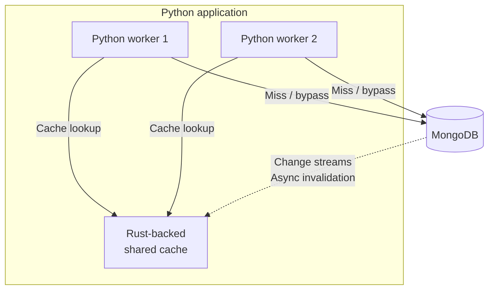
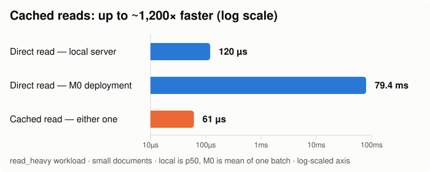

# Client-side query caching for PyMongo

[](https://pypi.org/project/client-query-cache/)
[](https://alessio-locatelli.github.io/client-query-cache/getting-started/installation/)
[](https://github.com/alessio-locatelli/client-query-cache/actions/workflows/test.yml)
[](https://pypi.org/project/client-query-cache/)

**Speed up read-heavy, high-throughput Python applications.** `client-query-cache` serves eligible repeated PyMongo reads from memory, reducing read latency and avoiding MongoDB round trips on cache hits.

Add caching through an explicit [cached collection view](https://alessio-locatelli.github.io/client-query-cache/usage/cached-reads/). Keep your existing MongoDB queries and use PyMongo for writes.

- **[Synchronous](https://alessio-locatelli.github.io/client-query-cache/getting-started/synchronous/) and [asyncio](https://alessio-locatelli.github.io/client-query-cache/getting-started/asyncio/) APIs** for long-lived Python applications.
- **[MongoDB change streams](https://alessio-locatelli.github.io/client-query-cache/usage/consistency/)** invalidate affected results, including writes from other applications.
- **[Shared caching across application workers](https://alessio-locatelli.github.io/client-query-cache/operations/shared-cache/)** on one [supported Linux host](https://alessio-locatelli.github.io/client-query-cache/getting-started/installation/#requirements) reduces duplicate cached documents and uses one change stream per active database.
- **[A Rust-backed shared cache](https://alessio-locatelli.github.io/client-query-cache/benchmarks/shared-cache/)** serves eligible warm reads from native shared memory without a MongoDB round trip.

Choose `CacheManager` for caching within one process, or `SharedCacheManager` to reuse eligible collection reads across trusted same-host workers. Both support sync and asyncio. See [which manager to choose](https://alessio-locatelli.github.io/client-query-cache/getting-started/choose-a-manager/).

With shared caching, workers look up the same cache and use their own PyMongo clients for misses and bypasses:



[Benchmarks](https://alessio-locatelli.github.io/client-query-cache/benchmarks/shared-cache/) compare direct reads, independent caches and shared caching. Sharing avoids duplicated values and streams, but its owner process and cache misses have costs. Rust does not guarantee a faster application or lower total memory for every workload.



The graphic shows [process-local measurements from local MongoDB and Atlas deployments](https://alessio-locatelli.github.io/client-query-cache/benchmarks/#illustrative-read-latency); it is separate from the shared-cache comparison above.

## Quick start

```bash
uv add client-query-cache
```

Or use `pip install client-query-cache`.

Start a MongoDB server before running this example. For local development, follow the [single-member replica-set setup](https://alessio-locatelli.github.io/client-query-cache/getting-started/installation/#local-mongodb).

```python
from pymongo import MongoClient
from pymongo.errors import ServerSelectionTimeoutError

from client_query_cache import CacheManager


class MongoDBSetupError(RuntimeError):
    pass


with (
    MongoClient("mongodb://localhost:27017") as client,
    CacheManager(client) as cache_manager,
):
    collection = client["client_query_cache_tutorial"]["items"]
    cached_collection = cache_manager.get_cached_collection(collection)
    try:
        collection.replace_one(
            {"_id": "example"}, {"_id": "example", "value": 42}, upsert=True
        )
    except ServerSelectionTimeoutError as exc:
        raise MongoDBSetupError(
            "MongoDB is unavailable at localhost:27017. Start a local server "
            "or update the connection URI. Setup: "
            "https://alessio-locatelli.github.io/client-query-cache/"
            "getting-started/installation/#local-mongodb"
        ) from exc
    cached_collection.find_one({"_id": "example"})
    cached_collection.find_one({"_id": "example"})  # Repeated reads can hit the cache.
```

Check the [platform and MongoDB requirements](https://alessio-locatelli.github.io/client-query-cache/getting-started/installation/#requirements) before installing. [Read eligibility](https://alessio-locatelli.github.io/client-query-cache/reference/api/#bypass-conditions) determines which requests can use the cache.

Invalidation is asynchronous: cached reads can briefly return a preceding value after a write. Use direct PyMongo reads with suitable consistency controls for read-after-write and current authorization; see [consistency](https://alessio-locatelli.github.io/client-query-cache/usage/consistency/).

## Run an application

Start with the [synchronous](https://alessio-locatelli.github.io/client-query-cache/getting-started/synchronous/) or [asyncio](https://alessio-locatelli.github.io/client-query-cache/getting-started/asyncio/) tutorial. The [shared FastAPI example](https://alessio-locatelli.github.io/client-query-cache/examples/fastapi-shared/) runs real Granian workers and verifies cross-process hits, invalidation and graceful shutdown. The [compact FastAPI example](https://alessio-locatelli.github.io/client-query-cache/examples/fastapi-minimal/) demonstrates process-local caching.

[Deployment](https://alessio-locatelli.github.io/client-query-cache/operations/) · [API reference](https://alessio-locatelli.github.io/client-query-cache/reference/api/) · [Examples](https://alessio-locatelli.github.io/client-query-cache/examples/)

The library is tested against real MongoDB replica sets, including [concurrency stress tests](https://github.com/alessio-locatelli/client-query-cache/blob/main/docs/development/concurrency-stress-tests.md). Separate checks guard against [performance](https://github.com/alessio-locatelli/client-query-cache/blob/main/docs/development/performance-regression-guard.md) and [memory](https://github.com/alessio-locatelli/client-query-cache/blob/main/docs/development/memory-regression-tests.md) regressions.

---

> MongoDB is a registered trademark of MongoDB, Inc. This project is independent and is not affiliated with or endorsed by MongoDB, Inc.
